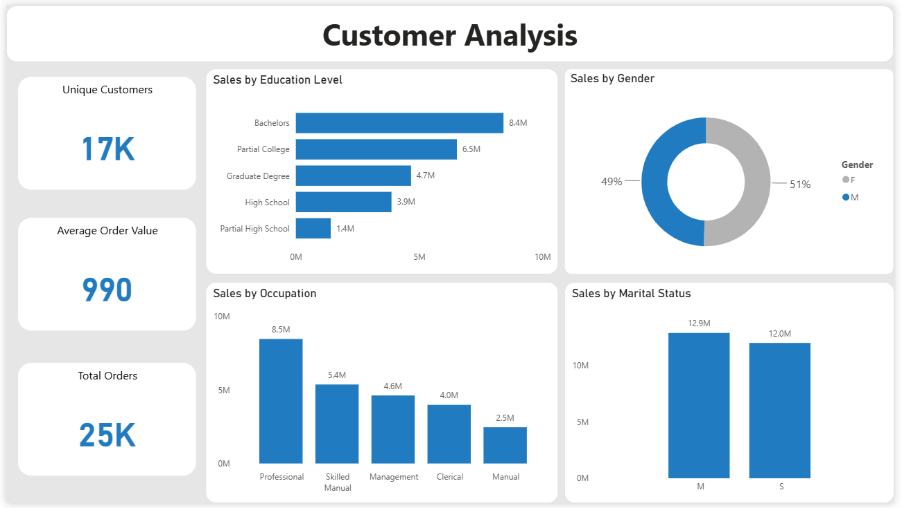
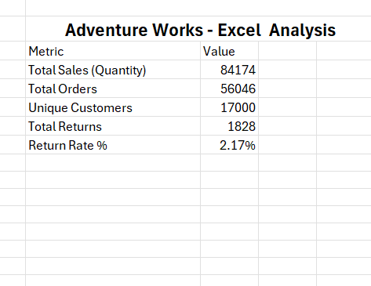

# Adventure Works Sales Analysis

## Project Overview

This is an end-to-end Business Intelligence project based on the Adventure Works sales dataset (2020 – mid 2022).  

The goal of this project is to analyze sales performance, profitability, product performance, customer behavior, and returns in order to provide actionable insights for the Sales and Finance teams.

The project follows a realistic company workflow:  
**Business Understanding → Data Understanding → Data Cleaning → Data Modeling → Analysis → Visualization → Insights**

---

## Business Questions Answered

- What is the overall sales and profit performance from 2020 to mid-2022?
- Which product categories and subcategories drive the highest revenue and profit?
- Which territories/countries perform best?
- What is the customer profile of high-value buyers?
- What is the return rate and which products have the highest returns?
- How did sales grow year over year?

---

## Tools & Technologies

- **Power BI** → Interactive dashboard with 4 pages + DAX measures
- **SQL Server** → Data cleaning, combining sales tables, data quality checks, and analytical queries
- **Excel** → KPI summary, Pivot Tables, and written insights
- **Python (Pandas + Matplotlib)** → Data exploration and visualization
- **Data Modeling** → Star Schema design

---

## Project Structure

```
AdventureWorks-Sales-Analysis/
├── Raw_Data/                          # Original CSV files
├── Adventureworks.pbix                # Power BI Dashboard
├── AdventureWorks_Analysis_Queries.sql
├── AdventureWorks_Excel_Analysis.xlsx
├── adventure_works_analysis.py
├── images/                            # Dashboard & chart screenshots
└── README.md
```

## Documentation

- [Data Dictionary](Data_Dictionary.md) → Description of all tables and columns

---

## Data Model

A **Star Schema** was designed with:

**Fact Tables:**
- Sales (combined 2020-2022)
- Returns

**Dimension Tables:**
- Product (with Category & Subcategory hierarchy)
- Customer
- Territory
- Calendar (Date)

---

## Key Insights

- Total Sales reached **$24.91M** with a strong Profit Margin of **42%** ($10.46M profit).
- Sales showed clear growth from 2020 to mid-2022, with a noticeable upward trend starting from mid-2021.
- **Bikes** generate the vast majority of revenue and profit, while **Accessories** lead in return volume (61.8% of total returns).
- The **United States** is the top-performing market, followed by Australia.
- Customers with higher education levels (Bachelor’s and Graduate degrees) and Professional occupations contribute the highest sales.
- Overall Return Rate is low at **2.17%**, but specific products like the Water Bottle – 30 oz. have relatively high return counts.
- Average Order Value stands at **$990**, with approximately 17K unique customers and 25K total orders.

---

## Recommendations

- Focus marketing and inventory efforts on **Bikes**, especially the Mountain-200 series, as they drive most of the profit.
- Investigate the high return volume in **Accessories** (particularly water bottles and tire-related products) to reduce return costs.
- Strengthen presence in the **United States** market while analyzing growth opportunities in Europe and Pacific regions.
- Target higher-educated and professional customers in future marketing campaigns, as they show higher purchasing power.

---

## Power BI Dashboard

The dashboard contains 4 pages:

1. **Executive Overview**  
   High-level KPIs, sales trend over time, sales by country and product category


2. **Sales & Product Analysis**  
   Profit by category, sales by subcategory, Top 10 products by sales


3. **Customer Analysis**  
   Sales by education level, gender, occupation, and marital status



4. **Territory & Returns**  
   Returns by category and country, sales by continent, top returned products


**Main DAX Measures created:**  
Total Sales, Total Profit, Profit Margin %, Return Rate %, Year-over-Year Growth %, Average Order Value

---

## SQL Work

- Combined Sales 2020, 2021, and 2022 into a single fact table
- Performed data quality checks (nulls, orphan keys, invalid quantities)
- Created analytical queries for KPIs, trends, top products, and return rate
- Built a reusable view (`vw_SalesDetails`)

---

## Excel & Python Analysis

- Excel: Summary KPIs + Pivot Tables for monthly trends and top products
- Python: Data aggregation and a bar chart showing yearly sales growth




---

## How to Run

1. **SQL**: Open the `.sql` file in SQL Server Management Studio and execute
2. **Power BI**: Open the `.pbix` file
3. **Excel**: Open the `.xlsx` file
4. **Python**: Run `adventure_works_analysis.py` (requires pandas and matplotlib)

---

## Skills Demonstrated

- Business Understanding & Requirements Gathering
- Data Cleaning & ETL
- Star Schema Data Modeling
- SQL (Joins, CTEs, Views, Data Quality)
- DAX (Calculations & Time Intelligence)
- Power BI Dashboard Design
- Data Visualization & Storytelling
- Python for Data Analysis

