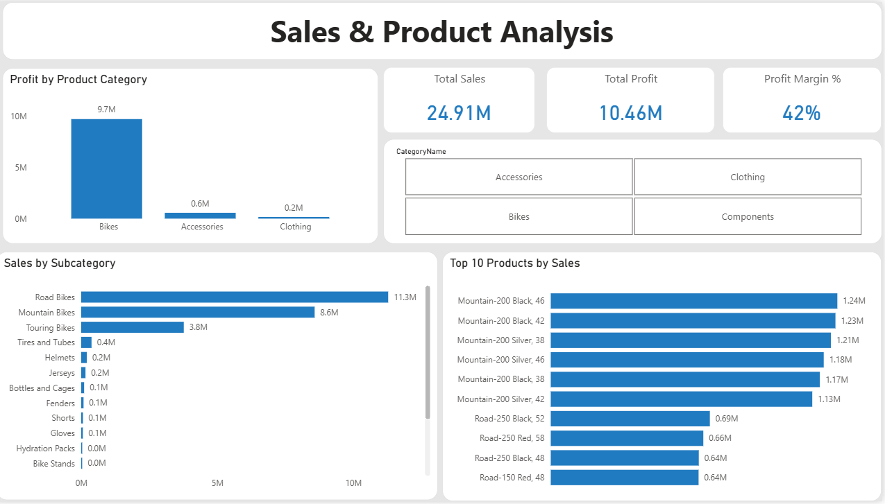

# Adventure Works Sales Analysis

End-to-end data analysis project using the Adventure Works sales dataset.  
The goal was to clean the data, build a proper data model, extract insights, and present the findings through multiple tools.

## Tools Used

- **Power BI** → Interactive dashboard (4 pages)
- **SQL Server** → Data cleaning, combining yearly sales tables, and analytical queries
- **Excel** → Summary KPIs, Pivot Tables, and written insights
- **Python (Pandas + Matplotlib)** → Data exploration, aggregation, and visualization

## Project Structure

- Raw_Data/ → Original CSV files
- Adventureworks.pbix → Power BI Dashboard
- AdventureWorks_Analysis_Queries.sql → SQL scripts
- AdventureWorks_Excel_Analysis.xlsx → Excel analysis
- adventure_works_analysis.py → Python script
- sales_by_year.png → Chart from Python

## Key Insights

- Total quantity sold: **84,174** units
- Sales grew significantly from 2020 to 2022
- Accessories dominate in volume, while Bikes drive revenue
- Overall return rate is low at **2.17%**
- United States is the strongest market

## Power BI Dashboard

The dashboard contains 4 pages:

1. **Executive Overview** — high-level KPIs, sales trend over time, sales by country and product category

2. **Sales & Product Analysis** — profit by category, sales by subcategory, top 10 products by sales

3. **Customer Analysis** — sales by education level, gender, occupation, and marital status

4. **Territory & Returns** — returns by category and country, sales by continent, top returned products

DAX measures were created for Total Sales, Profit, Profit Margin, Return Rate, and Year-over-Year growth.

## SQL Work

- Combined Sales 2020, 2021, and 2022 into a single table
- Performed data quality checks (nulls, orphan keys, invalid quantities)
- Created analytical queries for KPIs, trends, top products, and return rate
- Built a reusable view (vw_SalesDetails)

## Excel Analysis

- Summary sheet with main KPIs
- Pivot Tables for monthly trend and top products (2022)
- Written business insights

## Python Analysis

- Loaded and combined all sales years
- Calculated total quantity and top 10 products
- Analyzed sales by year
- Created and saved a bar chart showing yearly growth

## How to Run

1. SQL: Open the .sql file in SSMS and execute the queries
2. Power BI: Open the .pbix file
3. Excel: Open the .xlsx file
4. Python: Run adventure_works_analysis.py (requires pandas and matplotlib)

## Notes

This project follows a realistic workflow:  
Raw data → Cleaning & validation in SQL → Analysis in multiple tools → Visualization and insights.
