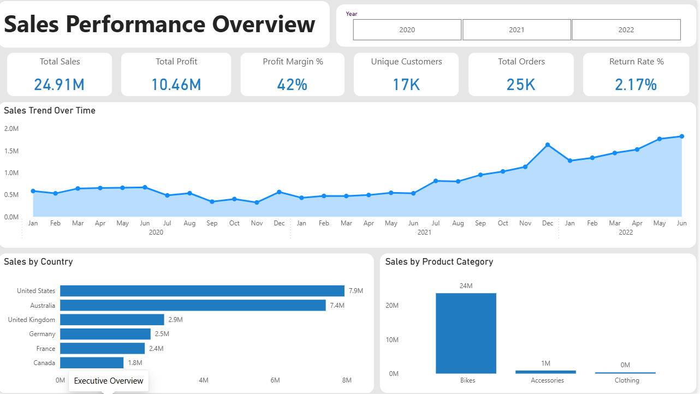
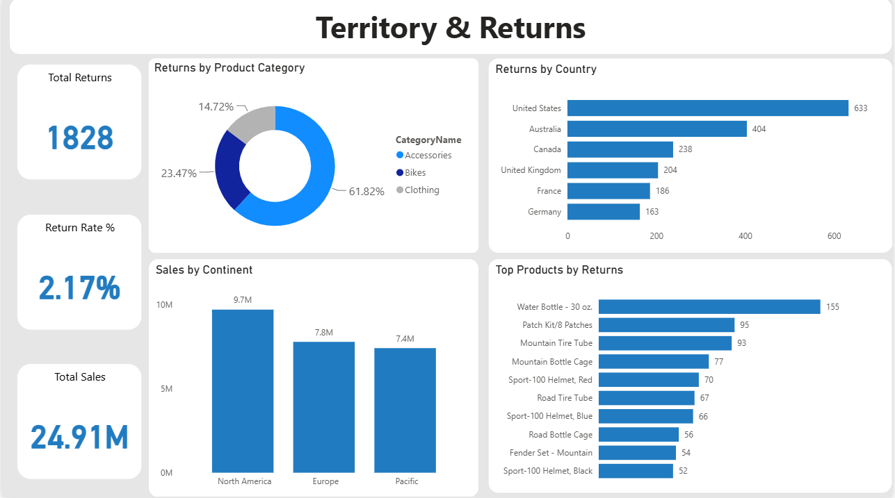
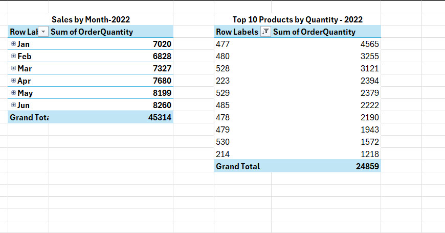
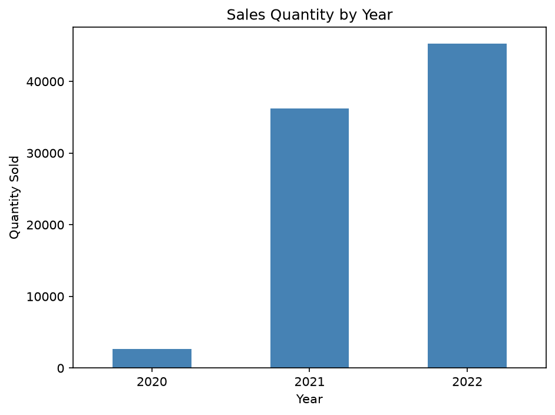

# Adventure Works Sales Analysis

## Project overview

This project explores sales, gross profit, products, customers, territories and returns from **1 January 2020 to 30 June 2022** using SQL Server, Power BI, Excel and Python.

The sales data is at **order-line level**, not one row per order. Revenue and gross profit are calculated using the product lookup's unit price and unit cost. These are analytical estimates, not audited net profit figures.

## Verified overall results

| Metric | Value | Definition |
|---|---:|---|
| Revenue | $24,914,586.82 | Quantity × product lookup price |
| Gross profit | $10,457,715.43 | Quantity × (lookup price − lookup cost) |
| Gross margin | 41.97% | Gross profit / revenue |
| Order lines | 56,046 | Rows in the combined sales table |
| Distinct orders | 25,164 | Distinct OrderNumber |
| Purchasing customers | 17,416 | Distinct CustomerKey in sales |
| Units sold | 84,174 | Sum of OrderQuantity |
| Average order value | $990.09 | Revenue / distinct orders |
| Returned units | 1,828 | Sum of ReturnQuantity |
| Returned-to-sold unit ratio | 2.17% | Returned units / units sold |

The returns data has no original order number. The ratio is a period-level unit comparison, not the percentage of orders returned or a matched sales-cohort return rate.

## Business questions

- What are the overall revenue, gross profit and order metrics?
- Which products, categories and countries contribute the most?
- How do revenue and unit volume change over time?
- Which customer groups contribute the most aggregate revenue?
- Which products have the highest returned-unit counts?

## Findings and interpretation

- Bikes contribute about $23.64M of revenue and $9.73M of gross profit, the largest amounts among the categories sold.
- The United States has the highest country revenue, about $7.94M, followed by Australia at $7.42M.
- Bachelor's degree customers contribute the most aggregate revenue ($8.42M), followed by Partial College ($6.53M) and Graduate Degree ($4.67M). Professional is the largest occupation group by aggregate revenue ($8.47M).
- These customer-group totals do not, by themselves, establish higher spending per customer or prove that education causes spending differences.
- Accessories account for 61.82% of returned units. This is their **share of returns**, not their category return rate. High-volume products can have many returns without having an unusually high return propensity.
- Full-year revenue increased from $6.40M in 2020 to $9.32M in 2021. January to June 2022 generated $9.19M. The 2022 data covers six months, so a full-year comparison would be misleading.
- Unit volume and revenue are different measures. The Python chart shows units, not revenue. Changes in product mix can make their trends differ.

## Recommendations

- Review inventory and commercial opportunities for the high-revenue Bikes category.
- Review Accessories returns relative to units sold, product mix and return reasons before deciding that quality is worse.
- Compare customer segments using both total revenue and revenue per purchasing customer before targeting marketing spend.
- Compare the same months across years when assessing growth, and keep the partial-2022 label visible.

## Power BI dashboard

The report has four pages. Its core measures use distinct order numbers and distinct purchasing customer keys.

### Executive overview


### Sales and product analysis


### Customer analysis


### Territory and returns


The model contains Sales and Returns fact tables, Customer, Territory and Date dimensions, and a Product → Subcategory → Category hierarchy. The separate category tables make the product hierarchy a snowflake extension rather than a completely flattened star schema.

Measures include Revenue (Total Sales), Total Profit, Gross Margin, Distinct Orders, Purchasing Customers, Average Order Value, Total Quantity and Returned-to-Sold Unit Ratio. Date relationships connect OrderDate and ReturnDate to the Date table.

For year-over-year measures, compare equivalent completed periods. A prior-period value that is absent should be shown as blank rather than interpreted as zero growth.

## SQL, Excel and Python

- `AdventureWorks_Analysis_Queries.sql` expects imported SQL tables. It distinguishes order lines from orders and includes quantity-based and revenue-based breakdowns.
- The published Power Query combines the yearly sales tables. The SQL file should not be treated as a complete database creation or raw-file import pipeline.
- `AdventureWorks_Excel_Analysis.xlsx` contains a summary plus January to June 2022 quantity pivots. The existing Summary sheet and its screenshot need two corrections: Total Orders should be 25,164, and exact Purchasing Customers should be 17,416. The displayed 56,046 is the order-line count. This README does not change the workbook or screenshot.
- The workbook's 2022 units do not rise every month: February (6,828) is below January (7,020). Overall January to June volume rises, with a February dip.
- `adventure_works_analysis.py` aggregates quantity and produces a quantity chart. It requires pandas and matplotlib.




## Data quality and limits

- The raw Customer Lookup CSV contains six blank/footer/non-customer records with non-numeric customer keys. The saved Power BI query removes the three marker records but still stores three unused blank/footer records. Remove all non-numeric customer-key records before importing this lookup into SQL; apply the same rule in Power Query when revising the report. No sales customer keys were missing from the valid lookup in this review.
- Prefix and some descriptive product fields have missing values. A missing optional description is not the same as a missing join key.
- Return records cannot be linked to individual original orders or customers with the supplied columns.
- Product prices and costs are lookup values, not transaction-level historical prices, discounts or operating expenses.
- The supplied files do not establish the causes of sales, returns or customer behavior.

## Files

```text
Raw_Data/                              Original CSV files
Adventureworks.pbix                     Power BI report
AdventureWorks_Analysis_Queries.sql     SQL analysis
AdventureWorks_Excel_Analysis.xlsx      Excel summary and 2022 pivots
adventure_works_analysis.py             Python quantity analysis
Data_Dictionary.md                     Table and column documentation
images/                                Screenshots and charts
README.md                              Project documentation
```

## How to use

1. Open `Adventureworks.pbix` in Power BI Desktop. Cached visuals can be viewed; refreshing requires updating its local CSV source paths to your `Raw_Data` folder.
2. For SQL, import the CSVs, combine yearly sales into `dbo.Sales`, and map the lookup tables to the names documented at the top of the SQL file. Importing and cleaning the source files is a prerequisite, not an automatic step in that script.
3. Open the Excel workbook and note the outstanding Summary and screenshot corrections above.
4. From the repository folder, install pandas and matplotlib, then run `python adventure_works_analysis.py`.

[Data dictionary](Data_Dictionary.md)
